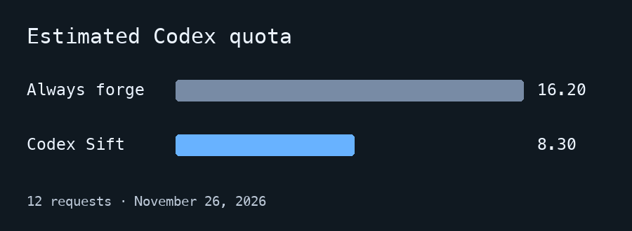
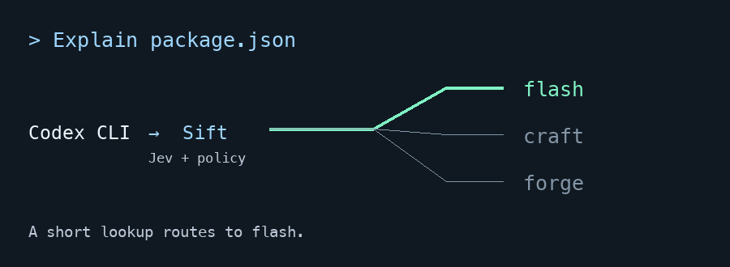

# Codex Sift

**Free, open-source model routing inside Codex CLI.**

Save your strongest model for the turns that need it.

[Install](#install) · [Demo](#routing-demo) · [Results](#how-much-usage-can-codex-sift-save) · [Commands](#commands) · [FAQ](https://codex-sift.vercel.app/#faq) · [Star history](#star-history)

[](https://github.com/romanmeclazcke/codex-sift/actions/workflows/test.yml)
[](LICENSE)
[](https://www.npmjs.com/package/codex-sift)
[](https://github.com/romanmeclazcke/codex-sift/stargazers)

Sift is a model router for the [OpenAI Codex CLI](https://developers.openai.com/codex). It keeps the native Codex experience, but routes each user turn to the cheapest model lane that should be able to handle it.

## How much usage can Codex Sift save?

**Codex Sift used 51.7% fewer total Codex tokens** in a live repository benchmark on November 27, 2026. Across three tasks repeated three times per strategy, input plus output fell from **1,349,986 to 652,498 tokens** compared with always using `gpt-5.6-sol` at high reasoning effort. Both strategies passed all nine runs. Sift passed 9/9 on the first attempt versus 8/9 for the fixed model, and cut mean time to passing tests by **28.3%** (70.8 s to 50.8 s).

Input includes cached tokens. Sift used **51.8% fewer input tokens** and **43.0% fewer output tokens**, while uncached input increased **45.7%**. The run measured CLI tokens and elapsed time. Billed cost, subscription quota and Jev usage were outside its scope. [Per-run measurements](https://github.com/romanmeclazcke/codex-sift/blob/main/reports/task-completion.json) · [Tasks and methodology](https://github.com/romanmeclazcke/codex-sift/tree/main/benchmarks/task-completion)

**Codex Sift used 48.8% less estimated Codex quota** in a November 26, 2026 routing test on 12 representative requests, compared with sending every request to the `forge` lane (`gpt-5.6-sol`, high reasoning effort). The routing policy estimates quota from model and reasoning-effort weights. The estimate is specific to this workload and policy. [Full routing report and per-request results](https://github.com/romanmeclazcke/codex-sift/blob/main/reports/e2e-routing.md)



In a separate live Codex CLI test on three short coding questions, the models selected by Sift used **8.7% fewer input tokens** than always using `forge` (54,458 vs. 59,654). Both strategies answered **3/3** correctly. Sift took 17.7 seconds in total and the fixed model took 16.0 seconds. Each strategy ran once, and the input counts include cached tokens. [Benchmark methodology and comparison](https://codex-sift.vercel.app/benchmark) · [Raw CLI measurements](https://github.com/romanmeclazcke/codex-sift/blob/main/reports/model-comparison.json)

To reproduce the routing test with your TypeSafe API key, run `npm ci` and `npm run e2e:report` from the repository.

The repository benchmark compares first-try success, completion, elapsed time, and reported tokens on repeated coding tasks. Run `npm run benchmark:tasks:smoke` after `npm ci` to verify the harness offline. [Fixtures and benchmark methodology](benchmarks/task-completion/README.md)

The problem is simple: coding sessions mix tiny asks, everyday implementation, and genuinely hard work. Running every turn on the strongest model is easy, but it spends premium quota on prompts like “explain this file”, “run the tests”, or “rename this helper”. Sift adds a small decision layer before Codex spends the turn.

On every **user turn**, Sift asks [TypeSafe Jev](https://docs.typesafe.ai) how hard the task is. Your YAML policy then picks a lane — **flash**, **craft**, or **forge** — and Codex runs against that model. You still talk to the native TUI.

Jev does not write code. It returns typed signals in about 300 ms. Sift’s YAML policy turns those signals into a model id.

This is a Codex-only router. It is not an MCP server, and it does not patch `~/.codex/config.toml`.

To get started, run `npx codex-sift setup` with Node.js 20+, the Codex CLI, and a TypeSafe API key. Then run `npx codex-sift` to launch Codex with routing enabled.

[Reduce Codex CLI token usage](https://codex-sift.vercel.app/guides/en) · [Cómo reducir el consumo de Codex CLI](https://codex-sift.vercel.app/guides/es) · [Routing benchmark](https://codex-sift.vercel.app/benchmark) · [Manual model switching vs Codex Sift](https://codex-sift.vercel.app/compare)

## Why this shape

Codex has no hook that can change the model *before* a turn is billed. The supported interception point is a custom `model_provider`. Sift starts a loopback Responses proxy, launches Codex with process-local `-c` overrides, and forwards your existing ChatGPT or API-key login upstream.

```text
you → codex-sift → Codex TUI
                      │
                      POST /responses  model=sift
                      │
                 Sift proxy (127.0.0.1)
                      │  Jev + policy.yaml
                      └─► chatgpt.com/backend-api/codex  or  api.openai.com
```

If you pin another model in `/model`, routing pauses. Pick **Sift** again to resume.

## Routing demo



| Example | Lane | Why |
| --- | --- | --- |
| Explain package.json | `flash` | Short lookup |
| Add a loading state to the form | `craft` | Bounded implementation |
| Plan a production migration | `forge` | High-stakes change |

[Try the interactive demo](https://codex-sift.vercel.app/)

## Install

Global (recommended):

```bash
npm install -g codex-sift
codex-sift setup
```

Or without a global install:

```bash
npx codex-sift setup
npx codex-sift
```

From this repo (development):

```bash
cd codex-sift
npm install
npm run build
npm link
codex-sift setup
```

`setup` lists your Codex models as `1, 2, 3`. You pick one for **flash**, **craft**, and **forge**. It can also save `TYPESAFE_API_KEY` to `~/.codex-sift/env` (mode 600) so you do not have to export it every session.

## Onboarding

The onboarding flow has three steps.

First, choose the concrete Codex model behind each lane:

```bash
codex-sift setup
```

The default mental model is:

| Lane | Use it for |
|---|---|
| `flash` | Questions, small ops, tiny edits |
| `craft` | Normal implementation and bounded debugging |
| `forge` | Hard diagnosis, architecture, auth, migrations, production-risk work |

Second, sanity-check your environment:

```bash
codex-sift doctor
```

This confirms Codex is available, your auth mode is detected, and the TypeSafe key is present for live Jev routing.

Third, start Codex through Sift from any project:

```bash
cd /path/to/your-project
codex-sift
```

`codex-sift` takes the same arguments as `codex`. Sessions, tools, sandbox, `/resume`, and permissions stay native.

```bash
codex-sift exec "explain src/cli.ts"
codex-sift resume --last
```

After any routed turn, inspect the latest decision:

```bash
codex-sift explain
```

Or, from inside Codex, use `$sift-explain`.

## Commands

| Command | Purpose |
|---|---|
| `codex-sift setup` | Onboarding: pick lane models by number |
| `codex-sift models` | Print the numbered Codex catalog |
| `codex-sift` | Interactive Codex with routing |
| `codex-sift route "…"` | Preview a routing decision |
| `codex-sift explain` | Show the last route and its latest observed response |
| `codex-sift report` | See lane mix, request outcomes, measured tokens, and policy-weighted savings |
| `codex-sift demo` | Classify a sample coding day with Jev; no Codex usage |
| `codex-sift doctor` | Codex binary, auth, Jev key |
| `codex-sift init` | Copy `policy.yaml` to `~/.codex-sift/` |
| `--sift-off` | Bypass the proxy for one invocation |

Inside Codex, `$sift-explain` runs `codex-sift explain`. A `route` preview is visible in `explain` and excluded from the report.

## Show the savings

After a session through `codex-sift`, run:

```bash
codex-sift report --since=today
codex-sift report --session=latest
codex-sift report --baseline=gpt-5.6-terra --baseline-effort=medium --json
```

The report counts completed, failed, incomplete, and canceled requests. It includes upstream latency and totals for the token fields the provider returned. `--session=latest` shows the decisions, continuations, and per-request outcomes for the latest session. Use `--session=<id>` with a session ID from the report to inspect an earlier session. Add `--live` to filter to live classifier decisions.

The savings estimate compares the policy weight of each eligible route with the policy weight of its baseline model and effort. It uses the weights saved at decision time. The default comparison is the Forge lane from the same policy. `--baseline=<model>` sets a model at medium effort, and `--baseline-effort=<effort>` sets the effort explicitly. Negative savings mean the routes used more estimated units than the baseline. The estimate includes live classifier tasks whose latest observed response completed. Legacy decisions are counted separately because their logs did not capture outcomes or weights.

Sift stores decision metadata in `decisions.jsonl` and per-request metadata in `outcomes.jsonl` under `SIFT_HOME`. Prompts, tool content, responses, and credentials are omitted by default. Set `SIFT_LOG_PROMPT_PREVIEW=1` to store a short preview with recognized secret patterns redacted. Earlier versions may have left raw previews in existing log files. The regular report and `explain` omit those legacy previews.

To show the idea without burning Codex quota, Jev-classify a canned day:

```bash
codex-sift demo
```

For a publishable E2E report with per-case tables:

```bash
npm run e2e:report
```

The E2E battery calls Jev for representative coding-agent prompts, compares each route against an always-forge baseline, and writes both human-readable Markdown and machine-readable JSON. It measures routing and quota efficiency; it does not claim response quality unless you manually run the same prompts through Codex and score the answers.

Weights live in `policy.yaml` as `usage_weight` × `effort_weight`. Tune them against `/usage` after a week of real sessions.

## Lanes

Edit the lanes in `~/.codex-sift/policy.yaml`, or run `codex-sift setup` again and type `1`, `2`, `3`. First matching rule wins.

| Lane | Default model | Use |
|---|---|---|
| `flash` | `gpt-5.6-luna` | Lookups, ops, tiny edits |
| `craft` | `gpt-5.6-terra` | Everyday implementation |
| `forge` | `gpt-5.6-sol` | Hard, high-stakes, or uncertain work |

Jev is asked atomic questions (`task_kind`, `difficulty`, `needs_reasoning`, `needs_planning`, `high_stakes`, `cross_cutting`). The policy never asks Jev “which model?”.

If Jev times out or `TYPESAFE_API_KEY` is missing, Sift fail-opens to `on_jev_down` (default `craft`) and marks the decision `degraded`.

## What is not routed

- Tool-loop continuations of the same user turn (the chosen model stays pinned)
- `codex-auto-review` and compact/review prompts
- Codex housekeeping that is not a `/responses` call
- Invocations with `-m` / `--model` pointing at a real model

## Auth

Sift does not read your tokens to call OpenAI. Codex sends `Authorization` and, on ChatGPT login, `chatgpt-account-id`. The proxy forwards those headers:

- ChatGPT / OAuth → `https://chatgpt.com/backend-api/codex/responses`
- API key → `https://api.openai.com/v1/responses`

A ChatGPT token is not valid on the platform API. Do not point this proxy at `api.openai.com` while logged in with ChatGPT.

## Status line (optional)

```toml
# ~/.codex/config.toml
statusLine = "node /absolute/path/to/codex-sift/scripts/statusline.js"
```

## Configuration

| Variable | Meaning |
|---|---|
| `TYPESAFE_API_KEY` | Jev credentials |
| `TYPESAFE_BASE_URL` | Override, default `https://api.typesafe.ai` |
| `SIFT_POLICY` | Extra YAML overlay |
| `SIFT_HOME` | Directory for local policy and telemetry. Defaults to `~/.codex-sift` |
| `SIFT_LOG_PROMPT_PREVIEW=1` | Store a short, redacted prompt preview in local telemetry |
| `SIFT_DISABLED=1` | Disable routing |
| `CODEX_BIN` | Codex executable if it is not on `PATH` |
| `SIFT_CHATGPT_ORIGIN` / `SIFT_OPENAI_ORIGIN` | Test upstreams |

Pin `jev_model` in YAML (`jev-1.13.0`). Do not ship thresholds against `jev-latest`.

## Development

```bash
npm test
npm run build
npx tsx src/cli.ts route "rename the unused helper"
```

## License

MIT

## Star history

[](https://www.star-history.com/#romanmeclazcke/codex-sift&Date)
